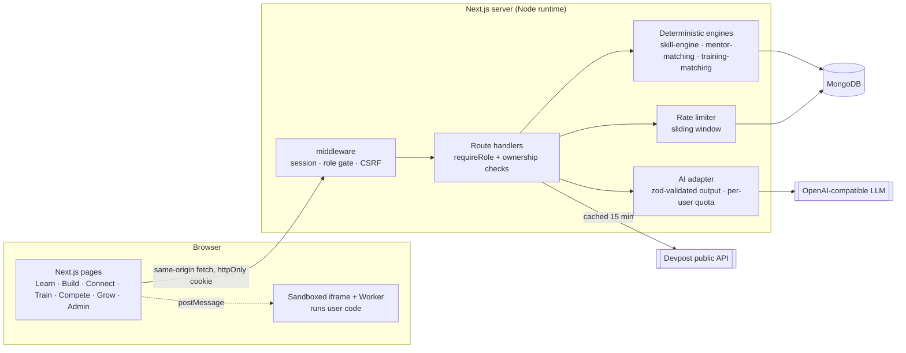

# GURUKOOL — Learn. Build. Connect. Compete. Grow. Train.

[](https://github.com/mohammedzeeshanxx1-boop/gurukool/actions/workflows/ci.yml)

A career platform for engineering students. It estimates what a student actually knows, plans what to learn next in the right order, and connects them to mentors, training, hackathons and recruiters, explaining every recommendation it makes.

**Stack:** Next.js 15 (App Router) · TypeScript (strict) · MongoDB + Mongoose · Tailwind · Monaco · any OpenAI-compatible LLM · Vitest · ESLint · GitHub Actions.

---

## What is technically interesting

Every module has a deterministic core algorithm. The LLM is an optional layer on top: its output is schema-validated, and whenever it is unavailable, rate-limited or malformed the deterministic engine takes over and the UI says so. No answer is ever faked.

| Module | Core algorithm | Code |
|---|---|---|
| **Learn** | **Skill Intelligence Engine:** a prerequisite DAG with three-colour DFS cycle detection, Bayesian (Beta–Bernoulli) mastery estimation with exponential time decay, and a priority-queue topological sort (Kahn + max-heap) to order the roadmap. Adaptive assessment uses uncertainty sampling. | `src/lib/skill-engine/` |
| **Connect** | **Mentor Match Engine:** a weighted, explainable multi-signal score (weakness 0.4, roadmap 0.3, goal 0.2, availability 0.1) with harmonic stage weighting and tiered term matching (direct → bidirectional synonyms → keywords). | `src/lib/mentor-matching/` |
| **Connect** | **Booking integrity:** IST wall-clock slots converted to UTC instants, atomic conditional state transitions, and unique partial indexes that make double-booking impossible at the database level. | `src/lib/slots.ts`, `src/models/connect.ts` |
| **Train** | **Training Recommender:** the same explainable scoring approach over course tags and module titles. Progress separates *engagement* (lessons done) from *demonstrated skill* (trainer-graded marks). | `src/lib/training-matching/` |
| **Compete** | **TF-IDF vector-space ranking:** live Devpost hackathons ranked by cosine similarity to the student's profile, using sublinear TF, smoothed IDF fitted on the current result set, field weighting and phrase/synonym folding. Each result shows its top contributing terms. | `src/lib/text/tfidf.ts`, `src/lib/compete-ranking.ts` |
| **Grow** | **ATS analyser:** priority-weighted keyword coverage where skills *demonstrated* in a project score full credit and *listed-only* skills score half, plus impact (action verbs, quantified results), structure and links. Runs live as the student types. | `src/lib/ats.ts` |
| **Build** | **Isolated code execution:** user code runs in a Web Worker inside a `sandbox="allow-scripts"` iframe (opaque origin) with its own CSP and a kill timer. It never runs on the server. | `src/components/sandboxRunner.ts` |
| **Platform** | **Security:** scrypt password hashes, HMAC-signed sessions re-validated against the DB on every request, sliding-window-counter rate limiting (atomic Mongo upserts), Origin-based CSRF checks, and security headers. | `src/lib/security/`, `src/middleware.ts` |

The reasoning behind each choice, and the alternatives rejected, is written up in **[docs/adr/](docs/adr/)**.

## Architecture



### The Learn pipeline (Skill Intelligence Engine)

```
quiz answers (weight 1) ─┐
trainer-graded marks (3) ├─► Beta(α,β) per skill, evidence decayed with a 60-day half-life
self-reported skills ────┘     ├─ mean, sd, 80% credible lower bound
                               ├─ status: mastered (lower ≥ 0.6) · developing · gap
                               ├─► next assessment = highest-uncertainty skills  (uncertainty sampling)
                               └─► roadmap = prerequisite closure of goal skills
                                          → drop mastered
                                          → Kahn topological sort, max-heap on urgency
                                             urgency = (1 − mean) × importance (importance inherited by prerequisites)
                                          → each stage carries a "why" and its prerequisites
```

Self-reported skills only move the prior. They can never make a skill "mastered" without evidence.

## Run it locally

```bash
npm install
cp .env.example .env.local     # fill in MONGODB_URI and AUTH_SECRET at minimum
npm run create-user -- --role admin --email you@example.com --password '<strong password>' --name "Admin"
npm run dev                    # http://localhost:3000
```

| Variable | Purpose |
|---|---|
| `MONGODB_URI` | MongoDB connection string (required) |
| `AUTH_SECRET` | ≥16 random characters used to sign session cookies |
| `AI_API_KEY`, `AI_MODEL`, `AI_BASE_URL` | Optional OpenAI-compatible LLM (OpenAI, Groq, OpenRouter, Ollama…). Without it, every feature still works through the deterministic engines. |
| `NEXT_PUBLIC_CONNECT_URL` | Shared video/collaboration link opened by "Join session" |
| `GURUKOOL_SHOW_DEMO_DATA` | `true` seeds clearly labelled fictional mentors, recruiters and a demo course |

## Quality gates

```bash
npm run check        # typecheck + lint + unit tests
npm run build        # production build
npm run test:flow    # end-to-end API flow against a running server + MongoDB
```

- **65 unit tests** (Vitest) cover the algorithms and security primitives: topological order invariants, cycle detection, Bayesian update and decay maths, adaptive topic selection, planner ordering, match scoring, IST→UTC slot expansion, password hashing, session-token forgery, route access rules, sliding-window maths including the boundary-burst case, the CSRF origin check, TF-IDF and ranking, the ATS analyser and LLM output validation.
- **CI** (GitHub Actions) runs typecheck → lint → tests → production build on every push and PR.
- Tests found real bugs. One example: synonym matching was one-directional, so a student topic "dsa" never matched a mentor who wrote "Data Structures & Algorithms". It is now bidirectional, and a test covers it.

## Security model

- **Authentication:** scrypt with a per-user salt, constant-time comparison, and the same error for unknown email and wrong password (no account enumeration).
- **Sessions:** an HMAC-SHA256-signed, httpOnly, SameSite=Lax cookie. Every API call re-reads the user from the DB, so suspending or un-approving someone takes effect immediately, not when the cookie expires.
- **Authorization:** role gates in middleware for pages, plus `requireRole` and ownership checks inside every route handler. Middleware alone is never trusted.
- **Four portals** (student, expert, recruiter, admin). Admins can't self-register. Recruiters and experts need admin approval.
- **Rate limiting:** sign-in is limited per IP *and* per account. Registrations are limited per IP, and AI calls per user. When a user hits the AI limit, the app falls back to the deterministic engine instead of failing.
- **CSRF:** state-changing `/api` requests must come from the same Origin.
- **Headers:** `X-Frame-Options: DENY`, `frame-ancestors 'none'`, `nosniff`, a strict Referrer-Policy, a Permissions-Policy and HSTS.
- **Secrets** live only in server code (`server-only` imports). `.env*` files are git-ignored.

See [ADR-0004](docs/adr/0004-security-model.md) for the trade-offs, such as why the app shell doesn't use a full script CSP.

## Project structure

```
src/app/                 pages (learn, build, connect, train, compete, grow, admin, portals)
src/app/api/             route handlers (auth, learn, mentors, mentor-sessions, train, recruiters, admin, compete, notifications)
src/lib/skill-engine/    graph.ts (DAG, topo sort) · mastery.ts (Bayesian model) · planner.ts · evidence.ts (DB → evidence)
src/lib/mentor-matching/ Mentor Match Engine
src/lib/training-matching/ Training Recommender
src/lib/text/            TF-IDF vector space model
src/lib/security/        sliding-window rate limiter, origin/CSRF check
src/lib/ats.ts           resume ATS analyser
src/lib/ai-schemas.ts    zod schemas for LLM output
src/models/              Mongoose models
tests/                   Vitest unit tests
docs/adr/                architecture decision records
```
